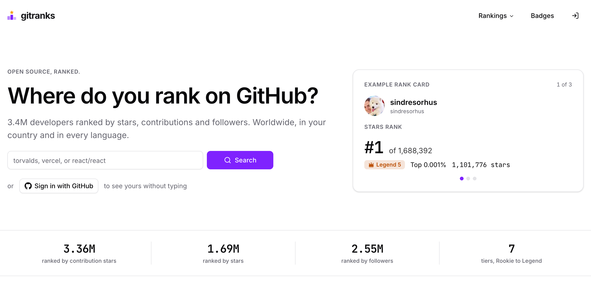
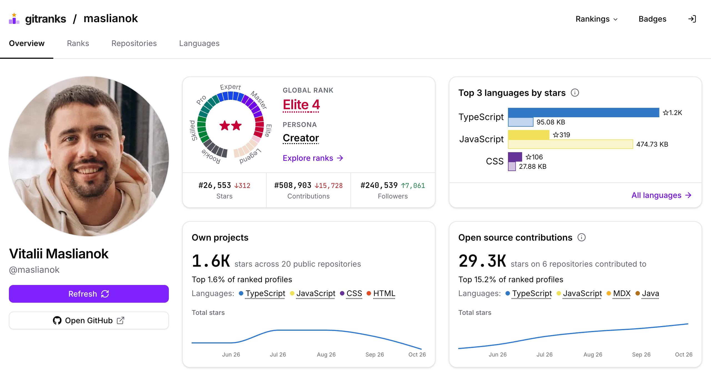
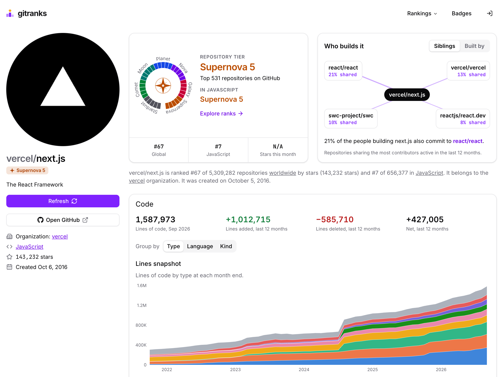

<div align="center">

<a href="https://gitranks.com">
  <picture>
    <source media="(prefers-color-scheme: dark)" srcset="public/logo-dark.svg">
    
  </picture>
</a>

### Where do you rank on GitHub?

Rankings, analytics and README badges for developers, repositories and organizations on GitHub.<br>
Worldwide, in your country and in every language.

<a href="https://gitranks.com/repo/gitranks/gitranks-ui"><picture><source media="(prefers-color-scheme: dark)" srcset="https://gitranks.com/badge/repo/gitranks/gitranks-ui/rank.svg?theme=dark"></picture></a>
<a href="https://gitranks.com/repo/gitranks/gitranks-ui"><picture><source media="(prefers-color-scheme: dark)" srcset="https://gitranks.com/badge/repo/gitranks/gitranks-ui/stars.svg?theme=dark"></picture></a>
<a href="https://gitranks.com/repo/gitranks/gitranks-ui"><picture><source media="(prefers-color-scheme: dark)" srcset="https://gitranks.com/badge/repo/gitranks/gitranks-ui/tier.svg?theme=dark"></picture></a>

**[Find your rank](https://gitranks.com)** · [Make a badge](https://gitranks.com/badge/builder) · [Badge gallery](https://gitranks.com/badge/gallery) · [How rankings work](https://gitranks.com/methodology) · [Insights](https://gitranks.com/insights)

<br>

<a href="https://gitranks.com">
  <picture>
    <source media="(prefers-color-scheme: dark)" srcset=".github/readme/hero-dark.png">
    
  </picture>
</a>

</div>

## What's inside

- **Developer rankings.** Three rankings: stars on your own repositories, stars on other people's repositories you have merged pull requests into, and followers. See each one worldwide, in your country and in every programming language.
- **Tiers.** Every ranked developer gets a tier, from Rookie to Legend, with five levels in each. Repositories get their own, from Stardust to Supernova.
- **Profiles.** Your ranks and how they moved month to month, your top languages, your own projects next to your open source contributions, and your most-starred repositories.
- **Repositories.** Global and language rank, star history, lines of code by type, contributors per month, top contributors and their countries, and *Who builds it*: the repositories that share the most contributors.
- **Organizations.** Rank, top repositories, code, contributors, contributors by country, and the organizations their contributors also work on.
- **README badges.** Shields, cards and charts for any developer, repository or organization. They update on their own as ranks change, and follow light and dark themes.
- **Insights.** Short posts about records, climbers and hidden gems, written from the rankings and shared on [X](https://x.com/gitranks), [Bluesky](https://bsky.app/profile/gitranks.bsky.social) and [Mastodon](https://mastodon.social/@github_pulse).
- **Rank updates in your messenger.** Get your rank daily or weekly from the [Telegram bot](https://t.me/gitranksbot), or on WhatsApp (the link is on every profile page).

## Badges for your README

Every badge is a live image. Pick one in the **[badge builder](https://gitranks.com/badge/builder)**: find a developer, repository or organization, choose a badge, style it, and copy the Markdown or HTML. More examples are in the **[gallery](https://gitranks.com/badge/gallery)**.

#### Developers

<a href="https://gitranks.com/profile/sindresorhus"><picture><source media="(prefers-color-scheme: dark)" srcset="https://gitranks.com/badge/user/sindresorhus/rank.svg?theme=dark"></picture></a>
<a href="https://gitranks.com/profile/sindresorhus"><picture><source media="(prefers-color-scheme: dark)" srcset="https://gitranks.com/badge/user/sindresorhus/language-rank.svg?theme=dark"></picture></a>
<a href="https://gitranks.com/profile/sindresorhus"><picture><source media="(prefers-color-scheme: dark)" srcset="https://gitranks.com/badge/user/sindresorhus/month.svg?theme=dark"></picture></a>
<a href="https://gitranks.com/profile/sindresorhus"><picture><source media="(prefers-color-scheme: dark)" srcset="https://gitranks.com/badge/user/sindresorhus/tier.svg?theme=dark"></picture></a>

<a href="https://gitranks.com/profile/sindresorhus"><picture><source media="(prefers-color-scheme: dark)" srcset="https://gitranks.com/badge/user/sindresorhus/profile-card.svg?theme=dark"></picture></a>

#### Repositories

<a href="https://gitranks.com/repo/vercel/next.js"><picture><source media="(prefers-color-scheme: dark)" srcset="https://gitranks.com/badge/repo/vercel/next.js/rank.svg?theme=dark"></picture></a>
<a href="https://gitranks.com/repo/vercel/next.js"><picture><source media="(prefers-color-scheme: dark)" srcset="https://gitranks.com/badge/repo/vercel/next.js/language-rank.svg?theme=dark"></picture></a>
<a href="https://gitranks.com/repo/vercel/next.js"><picture><source media="(prefers-color-scheme: dark)" srcset="https://gitranks.com/badge/repo/vercel/next.js/contributors.svg?theme=dark"></picture></a>
<a href="https://gitranks.com/repo/vercel/next.js"><picture><source media="(prefers-color-scheme: dark)" srcset="https://gitranks.com/badge/repo/vercel/next.js/tier.svg?theme=dark"></picture></a>

<a href="https://gitranks.com/repo/vercel/next.js"><picture><source media="(prefers-color-scheme: dark)" srcset="https://gitranks.com/badge/repo/vercel/next.js/rank-card.svg?theme=dark"></picture></a>
<a href="https://gitranks.com/repo/vercel/next.js"><picture><source media="(prefers-color-scheme: dark)" srcset="https://gitranks.com/badge/repo/vercel/next.js/community-card.svg?theme=dark"></picture></a>

This repository's own star history, drawn by GitRanks:

<a href="https://gitranks.com/repo/gitranks/gitranks-ui"></a>

#### Organizations

<a href="https://gitranks.com/org/vercel"><picture><source media="(prefers-color-scheme: dark)" srcset="https://gitranks.com/badge/org/vercel/rank.svg?theme=dark"></picture></a>
<a href="https://gitranks.com/org/vercel"><picture><source media="(prefers-color-scheme: dark)" srcset="https://gitranks.com/badge/org/vercel/top-repo.svg?theme=dark"></picture></a>
<a href="https://gitranks.com/org/vercel"><picture><source media="(prefers-color-scheme: dark)" srcset="https://gitranks.com/badge/org/vercel/contributors.svg?theme=dark"></picture></a>
<a href="https://gitranks.com/org/vercel"><picture><source media="(prefers-color-scheme: dark)" srcset="https://gitranks.com/badge/org/vercel/stars.svg?theme=dark"></picture></a>

<a href="https://gitranks.com/org/vercel"><picture><source media="(prefers-color-scheme: dark)" srcset="https://gitranks.com/badge/org/vercel/org-card.svg?theme=dark"></picture></a>

#### Add one

The builder writes the snippet for you. In Markdown, a badge is a linked image:

```md
[](https://gitranks.com/profile/YOUR_LOGIN)
```

Badge URLs look like `https://gitranks.com/badge/{user|repo|org}/{name}/{badge}.svg`. With the default colors, an SVG badge follows the reader's system light or dark theme; the builder's HTML snippet follows GitHub's theme setting instead. A `.png` badge is drawn light, or dark with `?theme=dark`. Badge URLs from earlier versions keep working.

## A closer look

<table>
  <tr>
    <td width="50%" valign="top">
      <a href="https://gitranks.com/profile/maslianok">
        <picture>
          <source media="(prefers-color-scheme: dark)" srcset=".github/readme/profile-dark.png">
          
        </picture>
      </a>
      <p align="center"><b>Developer profile</b>: tier, ranks and their monthly moves, top languages, own projects and contributions.</p>
    </td>
    <td width="50%" valign="top">
      <a href="https://gitranks.com/repo/gitranks/gitranks-ui">
        <picture>
          <source media="(prefers-color-scheme: dark)" srcset=".github/readme/repo-dark.png">
          
        </picture>
      </a>
      <p align="center"><b>Repository page</b>: tier, global and language rank, <i>Who builds it</i>, star history, and below it the code and contributors over time.</p>
    </td>
  </tr>
</table>

## How the rankings work

| Ranking | What it counts | To be ranked |
| --- | --- | --- |
| **Stars** | Stars on repositories you own | 5+ stars |
| **Contributions** | Stars on other people's repositories where you have merged pull requests | 5+ stars on those repositories |
| **Followers** | Your followers on GitHub | 5+ followers |

Each ranking is available worldwide, by country and by language. Worldwide and organization ranks update about every second day, country and language ranks about every fourth day, and tiers weekly. Only public GitHub data is used. The details are on [How rankings work](https://gitranks.com/methodology).

<details>
<summary><b>Why am I not ranked?</b></summary>
<br>
Each ranking has a minimum: 5 stars on repositories you own, 5 stars on other people's repositories you have merged pull requests into, or 5 followers. Search for your login on <a href="https://gitranks.com">gitranks.com</a> to see where you stand.
</details>

<details>
<summary><b>Can I refresh my profile?</b></summary>
<br>
Yes. Sign in with GitHub and refresh your own profile once a day from your profile page, in return for a star on this repository.
</details>

<details>
<summary><b>How do I remove my data?</b></summary>
<br>
Sign in, open your profile, go to the <b>Privacy</b> tab and choose <b>Remove my data</b>. You can also ask by email. The <a href="https://gitranks.com/privacy#removal">Privacy page</a> explains both ways and what a removal deletes.
</details>

## Feedback

Found a bug or a rank that looks wrong? [Open an issue](https://github.com/gitranks/gitranks-ui/issues/new/choose). Have an idea for a metric or a badge? [Start a discussion](https://github.com/gitranks/gitranks-ui/discussions). Every report helps.

Building something with GitHub data? GitRanks shares the data it has collected for free. Write to [hello@gitranks.com](mailto:hello@gitranks.com).

## About this repository

This is the GitRanks website: the pages, the badge rendering and the badge builder. Data collection and ranking run separately and are not part of this repository.

Built with [Next.js](https://nextjs.org) 16, React 19, [Tailwind CSS](https://tailwindcss.com) 4, [shadcn/ui](https://ui.shadcn.com), [Recharts](https://recharts.org) and [Satori](https://github.com/vercel/satori) for the badges.

## Support

If GitRanks is useful to you, star the repository, put a badge in your README, or share your rank with a friend.

<sub>Built by [@maslianok](https://github.com/maslianok). Yes, I've checked my own rank.</sub>
